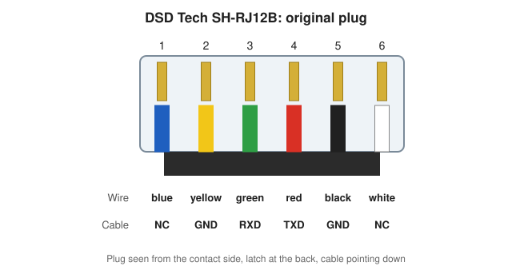
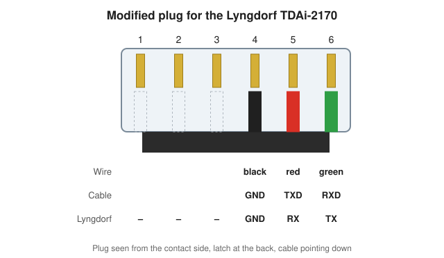
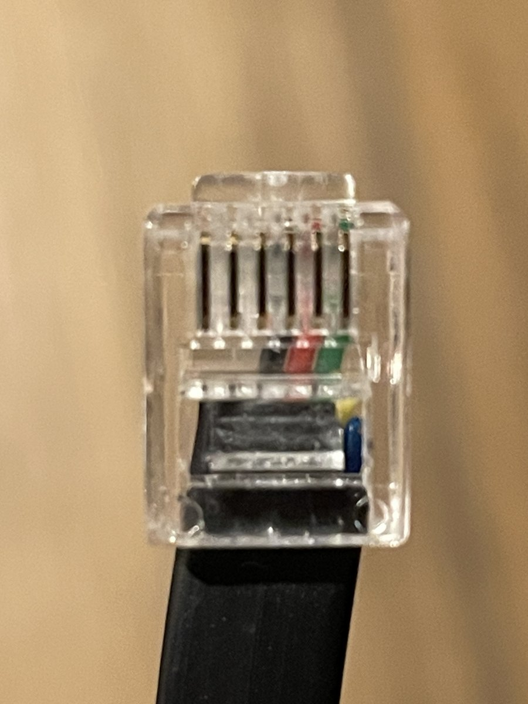

# Modifying the DSD Tech SH-RJ12B cable

The DSD Tech SH-RJ12B is a USB-to-RS232 cable with a CP2102N chip and an RJ12 plug.
Its plug does not match the RS232 port of the Lyngdorf TDAi-2170, so a new plug has to be
crimped on.

## Pinout

All diagrams show the plug **from the contact side, latch at the back, cable pointing down**.
In this view pin 1 is on the left.

### Original plug

| Pin | Wire colour | Signal (cable side) |
|:---:|-------------|---------------------|
| 1 | blue   | not connected |
| 2 | yellow | GND |
| 3 | green  | RXD (cable receives) |
| 4 | red    | TXD (cable transmits) |
| 5 | black  | GND |
| 6 | white  | not connected |

All six wires are connected in the original plug; only four carry a signal.

### What the TDAi-2170 expects

| Pin | Signal (amplifier side) |
|:---:|-------------------------|
| 4 | GND |
| 5 | RX (amplifier receives) |
| 6 | TX (amplifier transmits) |

Pins 1 to 3 are not used.

### Why the wires cross

RX and TX are named from the point of view of each device. What one side transmits, the
other side must receive:

| Cable | | TDAi-2170 |
|-------|:-:|-----------|
| TXD (red)   | → | pin 5, RX |
| RXD (green) | ← | pin 6, TX |
| GND (black) | — | pin 4, GND |

### Modified plug

| Pin | Wire colour | Cable signal | TDAi-2170 |
|:---:|-------------|--------------|-----------|
| 4 | black | GND | GND |
| 5 | red   | TXD | RX |
| 6 | green | RXD | TX |

## What you need

- A new **RJ12 plug with six contacts (6P6C)**. RJ12 plugs with only four contacts (6P4C)
  are also sold; those have no contact in position 6 and will not work.
- An RJ12 crimping tool.
- A sharp knife or cable stripper.

## Step by step

1. Cut the original RJ12 plug off the cable.
2. Strip about 5 to 6 mm of the outer jacket.
3. Cut the wires of the original pins 1, 2 and 6 (blue, yellow and white) short, close to
   the jacket. You are left with three wires in the order green – red – black.
4. Turn the cable over: rotate it half a turn (180°) around its length. The order of the
   remaining wires is now mirrored: black – red – green.
5. Push the three wires into the slots for **pins 4, 5 and 6**, on the right side of the
   plug in the view above:
   - black (originally pin 5) into pin 4 (Lyngdorf GND)
   - red (originally pin 4) into pin 5 (Lyngdorf RX)
   - green (originally pin 3) into pin 6 (Lyngdorf TX)

   Because of the flat shape of the cable, the three wires tend to slide into slots 2, 3
   and 4. Guide them carefully into the right-hand slots 4, 5 and 6.
6. Check the order once more, then crimp the plug firmly.

## Result

Black, red and green sit in positions 4, 5 and 6. The short stubs of the yellow and blue
wires are visible below them.
